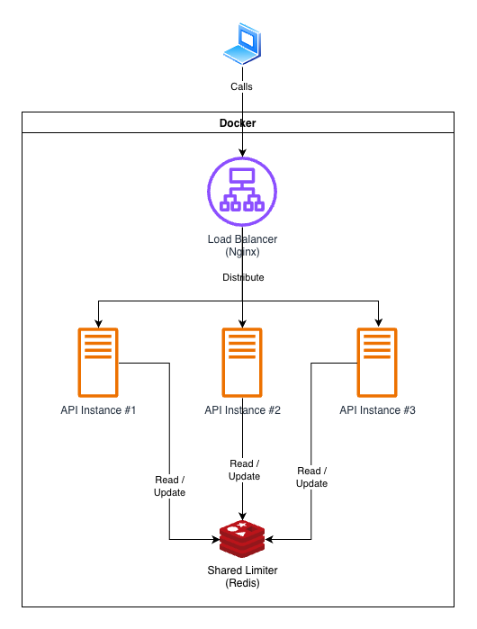

# Distributed Rate Limiter

I built this repository as a System Design and Backend Engineering case study for a common situation: API Rate Limiting. It might be used for situations like limiting an user API consumption according to its subscription tier or avoiding an user from swallowing most of the resources on your server like AI services have been doing (5h limits, weekly limits, and so on).

## The Challenge

The challenge is to design and implement a distributed rate limiter that will enforce the API usage limits regardless the backend server instance it's running - given the scalability is already predicted in this scenario.

### System Requirements

| Requirement               | Target                             |
| ------------------------- | ---------------------------------- |
| Bucket capacity           | 100 tokens/API Key                 |
| Refill rate               | 100 tokens/minute/API Key          |
| Backend instances         | 3+                                 |
| Rate limiting consistency | Atomic enforcement using Redis     |
| Added latency             | P95 < 10ms                         |
| Redis failure handling    | Local Token Bucket fallback        |

Token Bucket allows bursts and replenishes tokens continuously, so this is not a strict maximum of 100 requests in every rolling minute.

## Architecture



### Key Engineering Decisions

| Decision                   | Reason                           |
| -------------------------- | -------------------------------- |
| Redis instead of in-memory | Share state across API instances |
| Token Bucket               | Support controlled bursts        |
| Express 5                  | Compose the HTTP middleware flow |
| Lua Script                 | Atomic operations in Redis       |
| Docker Compose             | Allow to reproduce locally       |
| k6                         | Load and concurrency testing     |

### Implementation

This implementation has:

1. The HTTP API in Express 5, Node.js, and TypeScript.
2. A middleware to spot the API Key in the request.
3. Local rate limiter as a fallback during Redis outages.
4. Distributed rate limit using Redis.
5. Lua script for atomic operations.
6. Three API instances.
7. Load Balancer through Nginx.

Per-key policies are loaded from a JSON file at startup. The [technical design](./docs/02-technical-design.md) explains the request flow, failure handling, and trade-offs.

See the [implementation plan](./tasks/README.md) for task breakdown and acceptance criteria.

## Experiments

### Experiment 1: Concurrent requests across multiple instances

> **[PLACEHOLDER — INSTRUCTION]** Verify that the architecture enforces the shared limit when requests arrive simultaneously at different instances.

### Experiment 2: Redis unavailable

> **[PLACEHOLDER — INSTRUCTION]** Verify that the API continues serving requests with local limits during a Redis outage and returns to the shared limit after recovery, demonstrating the trade-off between availability and global consistency.

### Experiment 3: Latency overhead

> **[PLACEHOLDER — INSTRUCTION]** Measure the latency added by the rate limiter separately from total HTTP latency, and evaluate the P95 target of less than 10ms.

## How to run locally

Use Node.js 24 LTS (see `.nvmrc`) and npm. Install the locked dependencies with `npm ci`.

```bash
npm ci
npm run build
npm run lint
npm run typecheck
npm test
```

Source lives in `src/`, with unit tests in `tests/unit/` and real Redis checks in `tests/integration/`. The root `tsconfig.json` covers source, tests, and ESLint configuration for both editors and `npm run typecheck`, with explicit Node.js types. `tsconfig.build.json` emits source into `dist/`; tests compile into `.test-dist/`. Unit tests require no infrastructure and cover startup configuration and the built entry point.

Integration tests require Docker Compose or an existing Redis server:

```bash
docker compose up -d redis
npm run test:integration
docker compose down
```

The integration suite sends `PING` to real Redis and fails with setup instructions if it cannot connect. It defaults to `redis://127.0.0.1:6379`; export `REDIS_URL` to use another address. `.env.example` documents this variable; tests do not load `.env` automatically. Explicit suite paths make missing test files fail instead of reporting empty integration coverage.

Load policies at startup with `RATE_LIMIT_CONFIG_PATH=config/demo.json node dist/main.js`. The demonstration registers `demo-client` with defaults of 100 tokens and 100 tokens/minute, plus `demo-client-custom` with overrides. The JSON requires `defaults` (`capacity`, `refillPerMinute`) and a nonempty `clients` list; each client has a distinct, case-sensitive, whitespace-free `apiKey` and optional independent overrides. Policy values must be positive safe integers; request cost is always 1. Unknown fields are rejected.

`REDIS_TIMEOUT_MS` defaults to 20 and `REDIS_PROBE_INTERVAL_MS` to 1000; overrides must be positive safe integers in milliseconds. Export these variables explicitly; `.env` is not loaded automatically. Invalid configuration exits with a redacted error. Policies remain fixed for the process lifetime; experiments with different policies must use isolated bucket state. The shared registry exposes the same frozen policy for both store implementations and returns no policy for unknown keys.

`src/index.ts` exports the public modules; `src/main.ts` wires dependencies and runs the process. HTTP routes and middleware live under `src/http/`, and `main.ts` uses `app.listen()` and closes HTTP connections before Redis during shutdown. Importing these modules does not start the service.

Run the API with `RATE_LIMIT_CONFIG_PATH=config/demo.json node dist/main.js`, then request `GET /api/resource` with `X-API-Key: demo-client`. `GET /health` bypasses limiting. `PORT` defaults to 3000 (0 selects an ephemeral port); `INSTANCE_ID` defaults to `api-1` and accepts 1–64 ASCII letters, digits, dots, underscores, or hyphens. Responses expose this public label in `X-Instance-ID`; do not put secrets in it.

Resource responses include the token-bucket capacity and whole remaining tokens using the pinned Internet-Draft 11 header format. Denials return 429 with `Retry-After` rounded up to seconds, with a minimum of one. SIGTERM and SIGINT stop accepting requests and drain active connections for at most 10 seconds, then force-close remaining connections and close Redis. Repeated signals share the same shutdown operation.

### Development dependencies

TypeScript provides strict compilation and type checking; `@types/node` supplies Node.js types. ESLint with its JavaScript rules and `typescript-eslint` checks source, tests, and its own configuration, including deprecated API usage through type-aware linting. Node.js supplies the test runner and assertions, avoiding another test framework. The `redis` client supports the real Redis integration check and the documented shared-store architecture.
